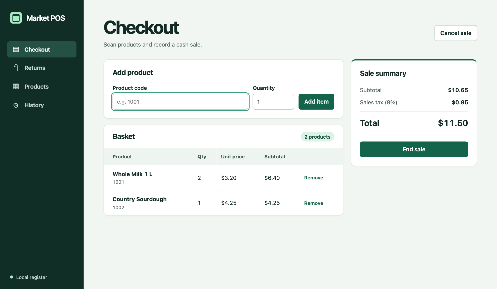
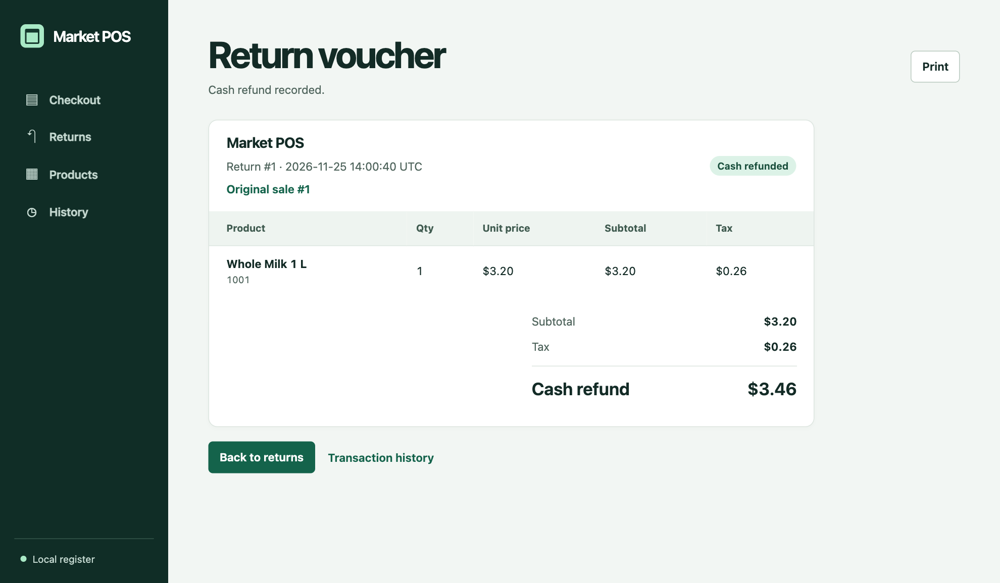

# Market POS

Market POS is a local point-of-sale register for a small supermarket. It implements cash checkout and returns against the original sale. Both workflows share the product catalog, inventory and transaction history in SQLite. The analysis and design follow Craig Larman’s NextGen POS case study.





## Run locally

Use Python 3.10 or later. Open a terminal in this directory.

```bash
python3 -m venv .venv
source .venv/bin/activate
python -m pip install -r requirements.txt
python -m database.init_db
python -m flask --app app run
```

On Windows PowerShell, use `py -3 -m venv .venv` and `.venv\Scripts\Activate.ps1`. Open the local URL printed by Flask, normally [http://127.0.0.1:5000](http://127.0.0.1:5000). If the port is occupied, add `--port 8501` and use port 8501 in the browser. The demo uses loopback and a single-store environment.

Initialization creates `database/pos.sqlite3` locally with six demo products and no completed transactions on a fresh checkout. `database/schema.sql` creates the schema and `database/seed.sql` inserts any missing demo products. Running initialization again preserves stored sales, returns and existing catalog entries. The application also initializes its selected database at startup. Set `POS_DATABASE` to choose a different database. For a clean recording in macOS or Linux, use an unused database filename:

```bash
python -m database.init_db --database database/recording.sqlite3
POS_DATABASE=database/recording.sqlite3 python -m flask --app app run --port 8501
```

To repeat the clean example, choose another unused filename. A server restart preserves committed transactions. By default it starts a new signing key and invalidates previous browser drafts. Set `POS_SECRET` in the environment to a stable random signing key if draft continuity across local restarts is needed.

## Try the two user goals

1. Choose **Checkout → New sale**. Enter code **1001** with quantity **2**, then **1002** with quantity **1**. The basket shows **$10.65** subtotal, **$0.85** tax and **$11.50** total.
2. Choose **End sale**. Recording **$10.00** shows a validation error. Record **$20.00** to get a numbered receipt and **$8.50** change. The **Products** page shows milk stock of **38** on a fresh database.
3. Choose **Returns** and find the actual sale number on the receipt. Try code **1001** with quantity **3** to see the eligibility check. Select quantity **1** and confirm **$3.46**. The return voucher links to the original sale and milk stock rises to **39**.
4. Open **History** to revisit the receipt and voucher. Select **Print** to use the browser’s print dialog. Use **Products** to search by code or name, add a product or update its description, price and reported stock.

The fixed demonstration tax is 8%, rounded per sale line. Partial refunds use the purchase price and a share of the recorded line tax. The SQLite transaction couples the inventory update with the sale or refund record. Returns require a known original sale and restockable merchandise.

## Run the tests

```bash
python -m unittest discover -s tests -v
```

Tests create isolated SQLite databases. See the [testing report](docs/reports/Testing_Report.md) and [actual unittest output](docs/reports/test_results.txt).

## Project files

| Deliverable | Location |
|---|---|
| Application entry point | [app.py](app.py) |
| Presentation, Application, Domain and Infrastructure source | [src/](src/) |
| SQLite schema, demo seed and initializer | [database/](database/) |
| Automated tests | [tests/](tests/) |
| Scrum plan, stories, estimates and burndown data | [Agile Project Plan](docs/agile/Agile_Project_Plan.md) |
| Simulated Sprint burndown | [Sprint_Burndown.png](docs/agile/Sprint_Burndown.png) |
| Fully dressed use cases | [Process Sale](docs/use_cases/UC01_Process_Sale.md), [Handle Returns](docs/use_cases/UC02_Handle_Returns.md) |
| Ten UML diagrams, sources and code traceability | [UML index](docs/diagrams/README.md) |
| Demo script and running-system captures | [Demo script](demo/Video_Demo_Script.md), [screenshots](demo/screenshots/) |

The technical report, quizzes and slide deck are separate course submission files.

## Git and GitHub workflow

The course repository is named **ProjectPos_2026**. Each member clones the team's repository, sets their own Git identity and uses a unique branch. Replace **member-id** with the branch name assigned by the team.

```bash
git switch main
git pull --ff-only
git switch -c member-id
# Make and test the assigned changes before staging them.
git add -p
git commit -m "Describe the actual work"
git push -u origin member-id
```

Open a pull request into `main` and attach test evidence. The maintainer reviews and merges it. Preserve all contributor branches and disable automatic head branch deletion in repository settings. Record each member’s actual commands during the work and capture the repository graph after integration:

```bash
git fetch --all
git log --all --graph --decorate --oneline
git branch -a
git remote -v
```

Before submission, fill the personal details and submission date in the report and quizzes. Add the verified GitHub and Bilibili links and real collaboration evidence to the editable report, then export the updated PDF. A submission rehearsal is described in the demo script.
