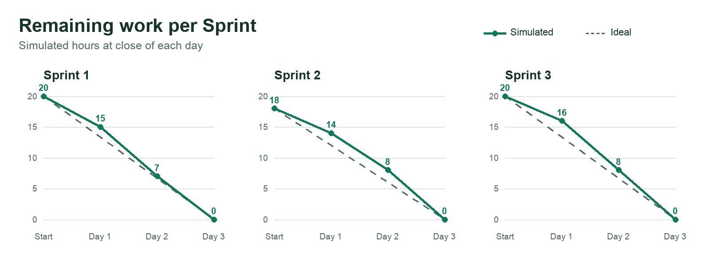

# Agile Project Plan

## Project Introduction

Market POS is a browser-based cash register for a small supermarket. The product goal is to complete a cash sale and a traceable return using the same inventory and transaction data. This Scrum plan proposes three consecutive three-day Sprints. It includes a simulated burndown and an actual-effort column for verified entries.

## Epics and ordered Product Backlog

| Order | ID | Epic | Priority | Sprint | Estimate (points) |
|---:|---|---|---|---:|---:|
| 1 | US01 | Cash checkout | P0 | 1 | 3 |
| 2 | US02 | Cash checkout | P0 | 1 | 5 |
| 3 | US03 | Cash checkout | P0 | 1 | 3 |
| 4 | US04 | Receipted returns | P0 | 2 | 3 |
| 5 | US05 | Receipted returns | P0 | 2 | 5 |
| 6 | US06 | Receipted returns | P0 | 2 | 3 |
| 7 | US07 | Stock and audit | P1 | 3 | 3 |
| 8 | US08 | Stock and audit | P1 | 3 | 2 |
| 9 | US09 | Delivery and verification | P1 | 3 | 5 |

P0 is essential for a core transaction. P1 supports operations or submission. Points express relative story size. Sprint tasks use estimated person-hours for capacity planning.

## User stories and acceptance criteria

| ID | User story | Acceptance criteria |
|---|---|---|
| US01 | As a cashier, I want to open a basket and enter products so I can build a sale. | Given a new basket, entering a known code and quantity shows the product and updates the line. Re-entering that code adds to its quantity. An unknown code leaves other lines unchanged. |
| US02 | As a cashier, I want to settle the basket in cash so I can give the right change. | Given two units of 1001 and one of 1002, the final amount is $11.50 with $0.85 tax. $10.00 is rejected. $20.00 commits the sale and shows $8.50 change. |
| US03 | As a customer, I want a receipt so I can prove what I purchased. | Given a committed sale, its numbered receipt shows the original lines, tax, tender and change. Changed stock is visible and the receipt can be opened again. |
| US04 | As a cashier, I want to find the sale so I can determine whether an item is returnable. | A valid sale number shows original items and remaining quantities. An unknown number or unrelated code produces an actionable error. |
| US05 | As a cashier, I want a validated refund quote so I can return the right amount. | A first one-unit return against the two units of 1001 quotes $3.46. A quantity greater than the remaining allowance is rejected. Repeated partial returns reconcile to the original charged amount. |
| US06 | As a customer, I want a cash refund voucher so I have evidence of the return. | A confirmed return issues a linked voucher and restores stock once. A duplicate commit for the same draft returns its original reference. |
| US07 | As a store operator, I want to search and edit products so I can keep catalog and stock information current. | Search by name or code finds matching products. Create rejects duplicate codes. Subsequent price changes preserve the original sale price in history. |
| US08 | As a cashier, I want to reopen transaction records so I can verify a payment or refund. | New sale and return records are listed after a restart. Each listed receipt or voucher opens, and the voucher links to the original sale. |
| US09 | As an assessor, I want repeatable evidence so I can check the implementation and design. | A fresh demo database supports the scripted workflow. Automated tests pass, UML sources render, and screenshots show actual UI states. |

## Sprint planning and task list

| Sprint | Goal | End-of-Sprint demonstration |
|---|---|---|
| 1 · Days 1–3 | Record a complete cash sale | Enter two products, reject insufficient tender, then show the saved receipt and reduced stock. |
| 2 · Days 4–6 | Reverse a purchase safely | Find the first sale, reject an excessive quantity, then show the voucher and restored stock. |
| 3 · Days 7–9 | Prepare the register for repeatable assessment | Edit catalog data, reopen records, replay both user goals and check report and UML traceability. |

| Task | Sprint | Stories | Priority | Work | Estimated hours | Actual hours |
|---|---:|---|---|---|---:|---|
| T01 | 1 | US01 | P0 | Draft sale use case, catalog and SQLite schema | 4 | Unrecorded |
| T02 | 1 | US01–02 | P0 | Implement basket, tax, tender and change | 7 | Unrecorded |
| T03 | 1 | US02–03 | P0 | Commit sale, decrement stock and show receipt | 5 | Unrecorded |
| T04 | 1 | US01–03 | P0 | Run checkout scenarios and review the sale increment | 4 | Unrecorded |
| T05 | 2 | US04 | P0 | Model original sale lookup and return visibility | 4 | Unrecorded |
| T06 | 2 | US05 | P0 | Implement quantity eligibility and partial tax allocation | 6 | Unrecorded |
| T07 | 2 | US06 | P0 | Implement atomic restock, voucher and duplicate handling | 5 | Unrecorded |
| T08 | 2 | US04–06 | P0 | Verify partial returns, conflicts and consistency | 3 | Unrecorded |
| T09 | 3 | US07–08 | P1 | Complete product maintenance and transaction history | 4 | Unrecorded |
| T10 | 3 | US09 | P1 | Align UML, requirements and application code | 6 | Unrecorded |
| T11 | 3 | US09 | P1 | Run regression tests and capture browser evidence | 4 | Unrecorded |
| T12 | 3 | US09 | P1 | Prepare report, presentation and demo materials | 6 | Unrecorded |

## Sprint burndown

| Sprint | Start | Day 1 | Day 2 | Day 3 |
|---|---:|---:|---:|---:|
| 1 | 20 | 15 | 7 | 0 |
| 2 | 18 | 14 | 8 | 0 |
| 3 | 20 | 16 | 8 | 0 |

Each point is **simulated remaining effort in hours** at close of day. An ideal line decreases uniformly from the estimated opening sum to zero. In live use, developers update the remaining estimate daily and record actual time spent separately. Verified sprint time logs, team meetings, and stakeholder sessions are unavailable.

## Team collaboration strategy

The proposed Product Owner orders work and accepts evidence. The Scrum Master facilitates planning, Daily Scrum, review and retrospective. Developers share implementation, modeling and tests. For a two-to-three-person course team, the members agree on accountabilities and a repository maintainer during kickoff. Each member works on a unique branch. The maintainer checks test evidence and merges pull requests into main, retaining the branches.

The Definition of Done requires an accepted scenario, automated checks for the affected behavior, consistent use-case and UML updates, a repeatable run from seeded data, and a reviewable pull request for work performed on the remote repository.

## Feedback and adaptation

- Planned Sprint 1 review. Run a cash transaction. If the cashier misses the tax or change, adjust its prominence and add a review check.
- Planned Sprint 2 review. Ask the reviewer to return one item and then try an excessive quantity. If the allowance is unclear, surface bought, selected, and remaining quantities together.
- Planned Sprint 3 review. Have a reviewer start from an empty database and follow the README. The retrospective would turn a reproducible setup problem into an owned corrective task.
- Implementation evidence. Automated checks reproduce a stale return quote and concurrent claims on the final unit. The delivered controller revalidates both during an SQLite write transaction. The browser demonstration confirms the visible checkout and return outcomes.

Planning framework: Schwaber and Sutherland, [The Scrum Guide](https://scrumguides.org/scrum-guide.html), 2020.
